# Lab 03: Use Delta Lake in Azure Databricks

## Overview

Delta Lake is an open-source project to build a transactional data storage layer for Spark on top of a data lake. Delta Lake adds support for relational semantics for both batch and streaming data operations, and enables the creation of a *Lakehouse* architecture in which Apache Spark can be used to process and query data in tables that are based on underlying files in the data lake.

In this lab, you'll learn about Delta Lake, which is an open source relational storage area for Spark that you can use to implement a data lakehouse architecture in Azure Databricks.

### Lab Objectives

In this lab, you will perform:

 - Task 1: Provision an Azure Databricks workspace
 - Task 2: Create a cluster
 - Task 3: Import the notebook and ingest data
 - Task 4: Load data into a Delta table
 - Task 5: Create catalog tables
 - Task 6: Compare managed tables and Delta files
 - Task 7: Use Delta tables for streaming data

## Task 1: Provision an Azure Databricks workspace

In this task, you'll use a script to provision a new Azure Databricks workspace.

1. In a web browser, navigate to the **Azure portal**, open the following URL in the address bar, and sign in with the Lab credentials if you are not already signed in.

    ```
    https://portal.azure.com
    ```
   
1. Use the **[\>_]** **icon** to the right of the search bar to create a new **Cloud Shell** in the Azure portal.

    

1. In the **Welcome to Azure Cloud Shell** pane, select **PowerShell**.

    

1. Within the Getting started pane, select **Mount storage account (1)**, select your **Storage account subscription (2)** from the dropdown and click **Apply (3)**.

    

1. In the **Mount storage account** pane, select **I want to create a storage account (1)** and click **Next (2)**.

    

1. In the **Create storage account** pane, provide the following details:

    - **Subscription (1)**: Select the defualt **Subscription**  
    - **Resource group (2)**: Select **Azure-Databricks**  
    - **Region (3)**: Select **(US) East US**  
    - **Storage account name (4)**: Enter **storage<inject key="DeploymentID" enableCopy="false"/>**  
    - **File share (5)**: Enter **fileshare1**  
    - select **Create (6)**.

        

1. In the **Deployment is in progress** notification, wait for the PowerShell terminal to start.

    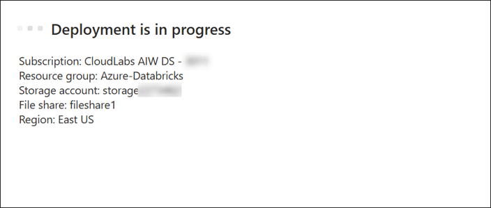

1. In the PowerShell pane, paste the following **commands** and click **Enter** to clone this repo:

    ```
    rm -r dp-203-azure-data-engineer -f
    git clone -b guidedlabs-Azure-Databricks --single-branch https://github.com/CloudLabs-MOC/dp-203-azure-data-engineer.git
    ```

    

1. After the repo has been cloned, enter the following commands to change to the folder for this lab and run the **setup.ps1** script it contains:

    ```
    cd dp-203-azure-data-engineer/Allfiles/labs/25
    ./setup.ps1
    ```

1. Wait for the script to complete (this may take a few minutes), and while waiting, review the following documentation.

    ```
    https://learn.microsoft.com/azure/databricks/introduction/delta-comparison
    ```

1. In the **Cloud Shell** window, select the **X** at the top right corner to close it after the script execution completes.

   

## Task 2: Create a cluster

Azure Databricks is a distributed processing platform that uses Apache Spark *clusters* to process data in parallel on multiple nodes. Each cluster consists of a driver node to coordinate the work and worker nodes to perform processing tasks.

In this task, you'll create a *single-node* cluster to minimize the compute resources used in the lab environment (in which resources may be constrained). In a production environment, you'd typically create a cluster with multiple worker nodes.

1. In the **Search resources, services, and docs (G+/) (1)** box, enter **dp203-**, and then select the **dp203-xxxxxxx (2)** resource group, where **xxxxxxx** is the suffix generated by the setup script.

    
 
1. In the **Overview (1)** page, select the **databricksxxxxxxx (2)** resource.

    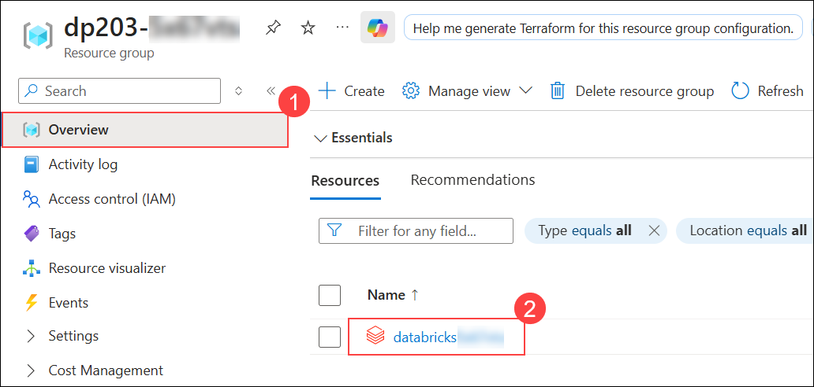

1. In the **Overview** page, select **Launch Workspace**.

    

    > **Note**: In the Databricks Workspace portal, dismiss any tips or notifications that appear, and continue with the lab instructions.

1. View the **Azure Databricks workspace portal** and note that the sidebar on the left side contains links for the various types of tasks you can perform.

1. Select the **+ New (1)** link in the sidebar, and then select **More (2)** ,then click on **Cluster (3)**.

    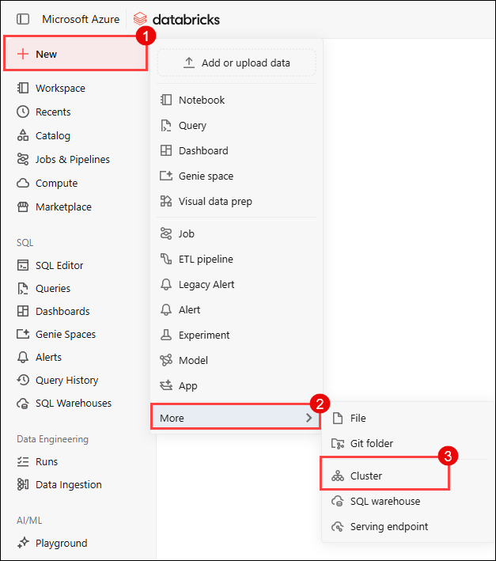
 
1. In the **Create new compute** page, provide the following details:

    - **Compute name (1)**: Keep the **default** value  
    - **Databricks runtime (2)**: Select **17.3 LTS**  
    - **Preferred node type (3)**: Select **Standard_DS3_v2**  
    - **Single node (4)**: Select  
    - **Terminate after (5)**: Enter **30** minutes  
    - select **Create (6)**.

        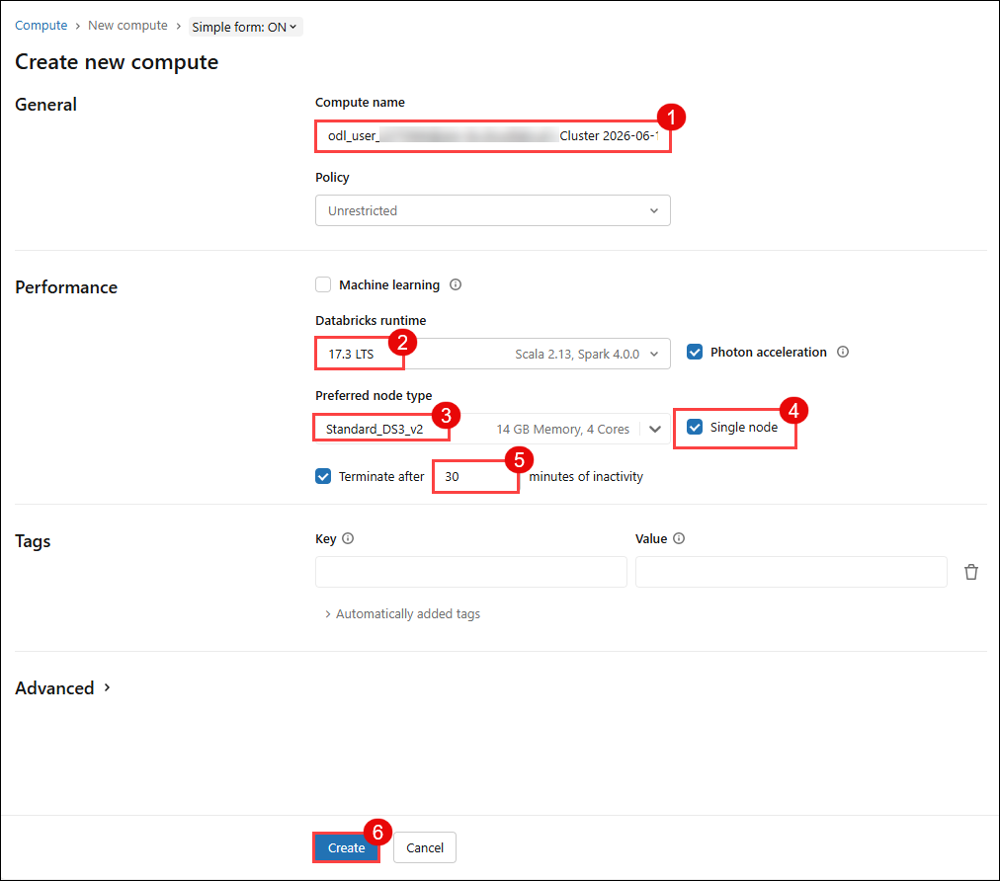

1. In the cluster page, wait until the status indicator shows the cluster is running.

    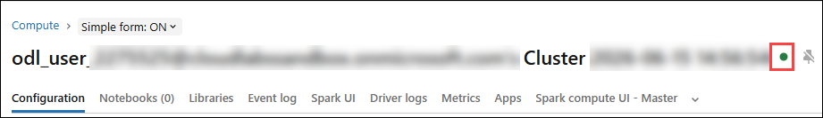

    > **Note**: If your cluster fails to start, your subscription may have insufficient quota in the region where your Azure Databricks workspace is provisioned. See [CPU core limit prevents cluster creation](https://docs.microsoft.com/azure/databricks/kb/clusters/azure-core-limit) for details. If this happens, you can try deleting your workspace and creating a new one in a different region. You can specify a region as a parameter for the setup script like this: `./setup.ps1 eastus`

## Task 3: Explore Delta Lake using a notebook

In this task, you'll use code in a notebook to explore Delta Lake in Azure Databricks.

1. Select **Workspace (1)** from the left navigation pane, and then choose **Home (2)** under the Workspace section.

   

1. Select the **More options (1)** menu, and then choose **Import (2)**.

   

1. In the **Import** dialog box, select **URL (1)**, enter the following link in the **URL (2)** field, and then choose **Import (3)**.

    ```
    https://github.com/CloudLabs-MOC/dp-203-azure-data-engineer/raw/guidedlabs-Azure-Databricks/Allfiles/labs/25/Delta-Lake.ipynb
    ```

   

1. Open the **Delta-Lake** notebook, and in the **Connect** drop-down list at the top right, select your cluster.

    > **Note**: If the cluster is not running, it may take a minute or so to start.

    > **Note**: If the cluster restarts during the lab, run the first code cell under **Ingest data** again before you continue, so that the notebook variables are set again.

   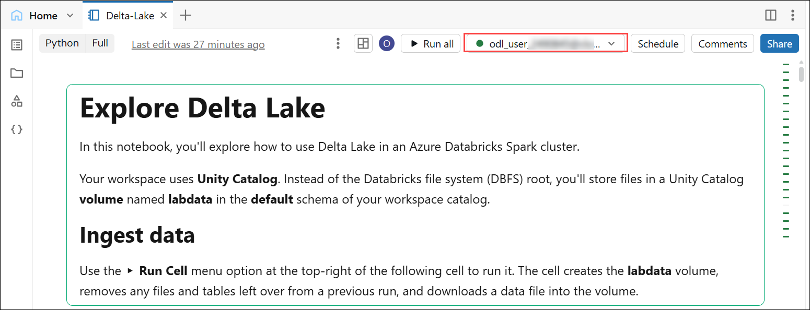

1. Under **Ingest data**, run the first code cell by selecting **&#9656; Run Cell**. The cell creates the **labdata** volume and downloads **products.csv** into it. In the output, note your catalog name, the volume path, and the **products.csv** file.

   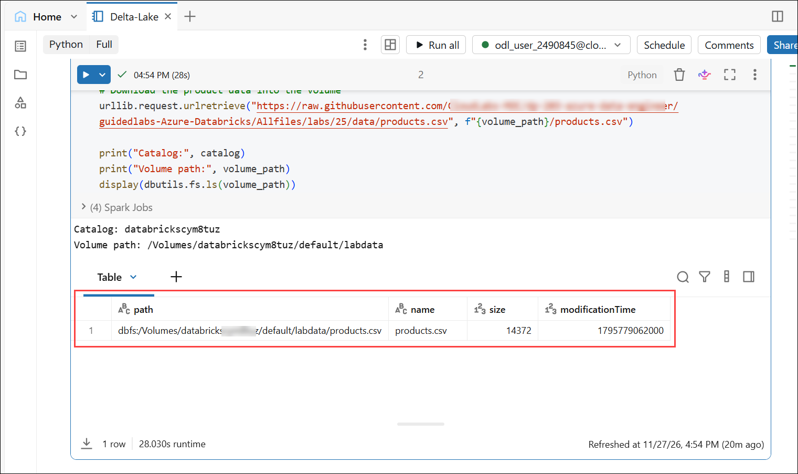

1. Run the next cell to load **products.csv** into a dataframe and display the first 10 rows.

   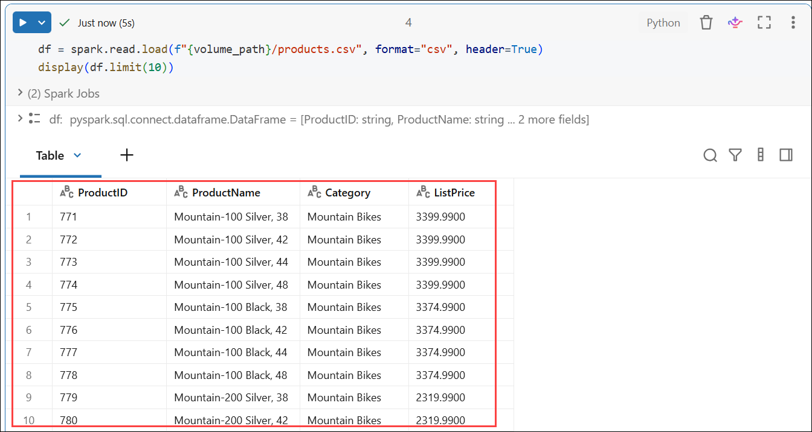

## Task 4: Load data into a Delta table

In this task, you'll save the dataframe in Delta format, update it, and use the transaction log to view earlier versions of the data.

1. Under **Load the file data into a delta table**, run the cell that saves the dataframe in Delta format to the **delta/products-delta** folder in the volume.

1. Run the next cell to list the folder contents. Note the Parquet data file and the **_delta_log** folder, which records every change to the data.

   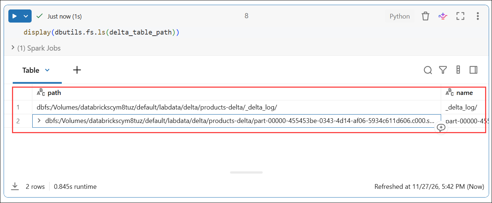

1. Run the next cell, which loads the data into a **DeltaTable** object and reduces the **ListPrice** of product **771** by 10%. The output shows the row for product **771** with the new price of **3059.991**.

   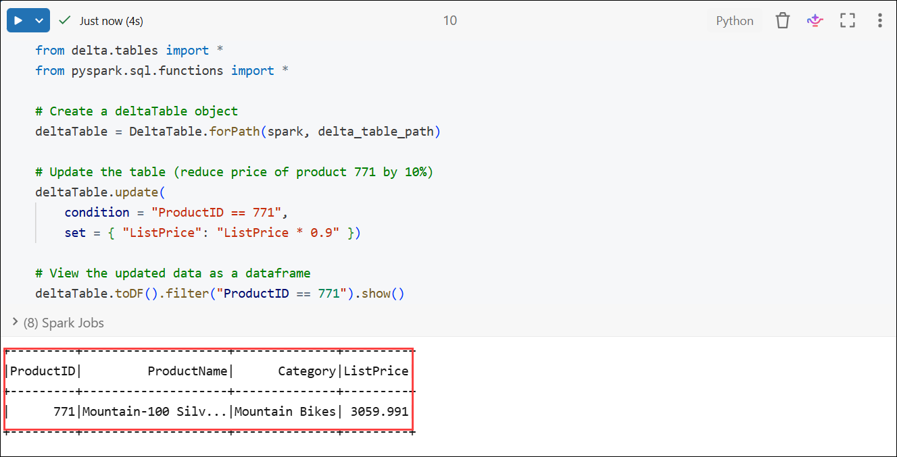

1. Run the next cell to load the Delta folder into a new dataframe, and verify that the update is reflected: product **771** shows a price of **3059.991**.

   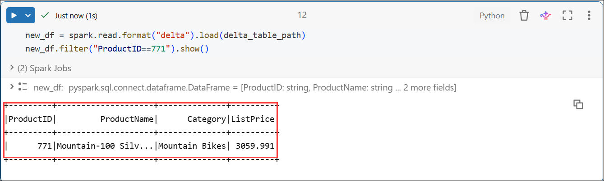

1. Run the cell that contains `option("versionAsOf", 0)`. It uses Delta Lake *time travel* to show the original data, in which product **771** still has a price of **3399.99**.

1. Run the cell that contains `deltaTable.history(10)` to view the history of changes: a **WRITE** at version **0** and an **UPDATE** at version **1**.

   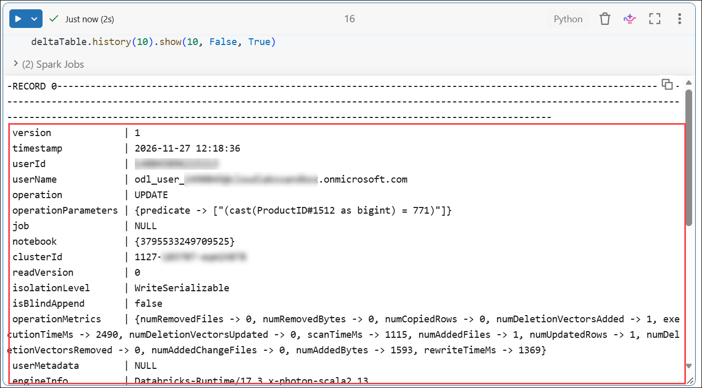

## Task 5: Create catalog tables

In this task, you'll query the Delta files directly by path, and then create a **managed** table in a new **AdventureWorks** schema so that the data can be queried by name with SQL.

1. Under **Query Delta files by path**, run the cell that queries the Delta files in the volume with SQL, without defining a table.

    > **Note**: An *external* table needs an external location that an administrator registers in Unity Catalog. This lab environment doesn't include one, so you won't create an external table.

1. Under **Create a managed table**, run the cell that creates the **AdventureWorks** schema and the **ProductsManaged** table. In the output, note that the **Type** is **MANAGED** and that the **Location** is an **abfss://** path in the storage that Unity Catalog manages for your catalog.

   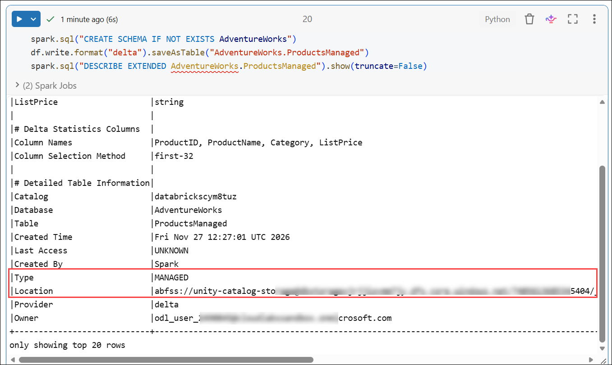

1. Run the next `%sql` cell to query the **ProductsManaged** table by name.

## Task 6: Compare managed tables and Delta files

In this task, you'll drop the managed table and compare what happens to its data with the Delta files in your volume.

1. Under **Compare managed tables and Delta files**, run the `SHOW TABLES` cell to list the tables in the **AdventureWorks** schema.

1. Run the cell that contains the `DROP TABLE` statement. Note that **ProductsManaged** is no longer listed. Unity Catalog deletes the data files of a dropped managed table for you.

   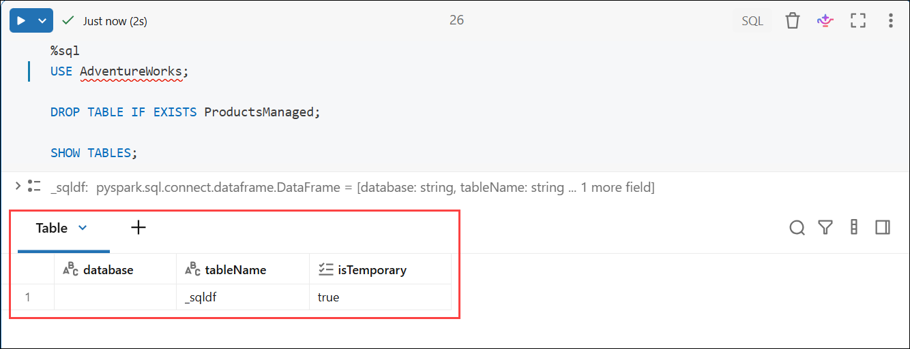

1. Run the next cell to list the **products-delta** folder, and verify that the Delta files in the volume are still there.

1. Run the next two cells to create a managed **Products** table from the Delta files and query it. Scroll to the last row, and note that product **771** has the updated price, because the table was created from the current version of the Delta files.

   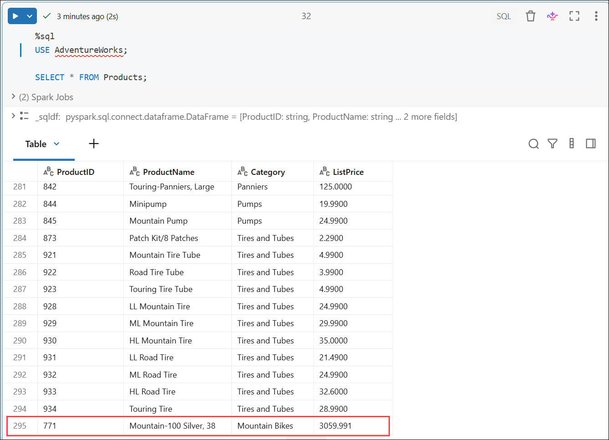

## Task 7: Use Delta tables for streaming data

In this task, you'll use a Delta table as a *sink* for a stream of simulated IoT device data.

1. Under **Use delta tables for streaming data**, run the cell that downloads **devices1.json** into the **device_stream** folder in the volume.

1. Run the next cell to create a stream that reads JSON files from the **device_stream** folder.

   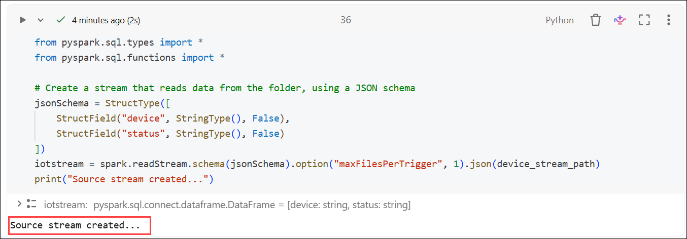

1. Run the next cell to start writing the stream to a managed Delta table named **IotDeviceData**.

   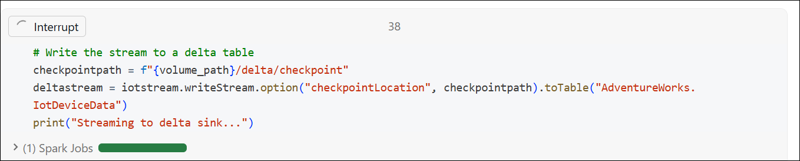

    > **Note**: The stream keeps running in the background until you stop it, so the cell continues to show **Interrupt** and a stream status panel. This is expected. Don't select **Interrupt**; continue with the next step.

1. Wait a few seconds, and then run the next `%sql` cell to query the **IotDeviceData** table. It contains **9** rows.

1. Run the cell that adds **devices2.json** to the stream folder. Wait a few seconds, and then run the next `%sql` cell. Verify that the table now contains **16** rows, including the new device records.

   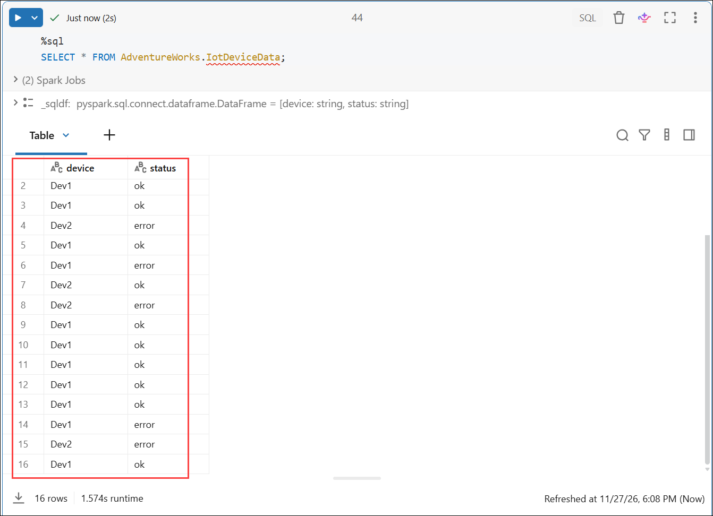

1. Run the last cell, `deltastream.stop()`, to stop the stream.

> **Congratulations** on completing the task! Now, it's time to validate it. Here are the steps:
> - Hit the Validate button for the corresponding task. If you receive a success message, you can proceed to the next task. 
> - If not, carefully read the error message and retry the step, following the instructions in the lab guide.
> - If you need any assistance, please contact us at cloudlabs-support@spektrasystems.com. We are available 24/7 to help
 
<validation step="0dca010a-adbc-4610-a1dc-52baca77d863" />

## Summary

In this lab, you provisioned an Azure Databricks workspace and a cluster, and used a notebook to work with Delta Lake. You saved data in Delta format in a Unity Catalog volume, updated it, and used time travel and the transaction log to view earlier versions. You then created managed tables, compared them with Delta files, and used a Delta table as a sink for streaming data.

## You have successfully completed the lab.
